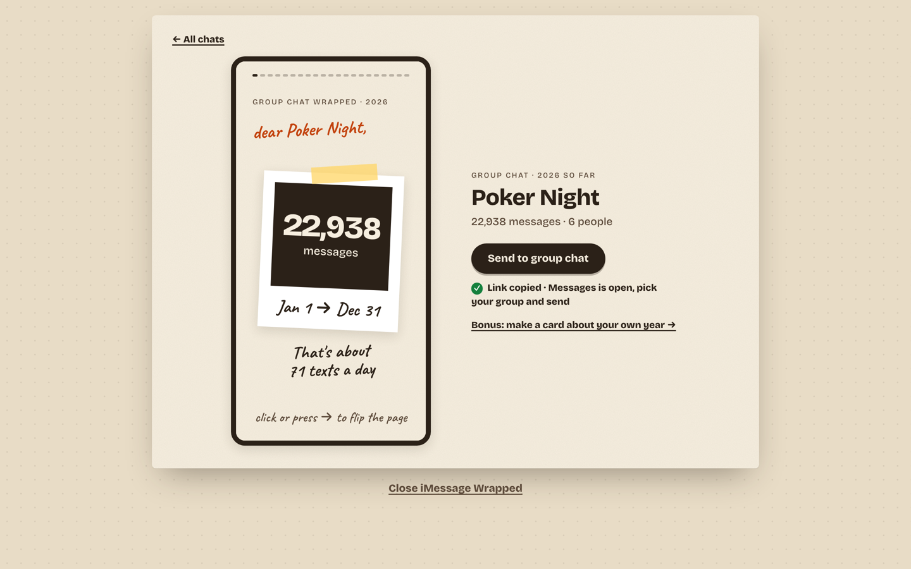
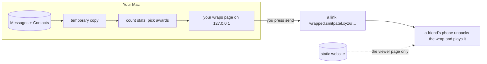

<p align="center"></p>

<h1 align="center">iMessage Wrapped <sup><sub>beta</sub></sup></h1>

<h3 align="center">the year's almost over. who did you actually text the most?</h3>

<p align="center">
  story slides + awards for your group chats. made on your mac.
</p>

<p align="center">
  Pick a group chat on your Mac and see who talks the most, who ghosts, who starts every
  conversation, and the chat's greatest hits. Send the group one link and they tap through it on
  any phone.
</p>

<p align="center">
  <a href="https://wrapped.smitpatel.xyz/#demo"><b>Try the demo</b></a> ·
  <a href="#install">Install</a> ·
  <a href="#how-your-data-stays-private">Privacy</a> ·
  <a href="https://wrapped.smitpatel.xyz">wrapped.smitpatel.xyz</a>
</p>

<p align="center">
  <a href="https://github.com/smitsp11/wrapped/releases"></a>
  <a href="https://github.com/smitsp11/wrapped/actions/workflows/ci.yml"></a>
  
  
  <a href="LICENSE"></a>
</p>

<p align="center">
  <a href="https://wrapped.smitpatel.xyz/#demo">
    
  </a>
  <br>
  <sub>Poker Night, a made-up group chat, tapped through on a phone. <a href="https://wrapped.smitpatel.xyz/#demo">Open the demo</a>.</sub>
</p>

## Install

On a Mac, open Terminal and paste:

```bash
curl -fsSL https://wrapped.smitpatel.xyz | sh
```

That's it. The installer downloads one program, checks it, and starts it. If your terminal app
can't read Messages yet, it asks you to flip one switch in System Settings (Full Disk Access,
[explained below](#why-full-disk-access)) and picks up by itself once macOS reopens your terminal.
Then it opens your wraps in the browser. Next time, type `wrapped`.

`wrapped` tells you when there's an update; run `wrapped update`.

You need a Mac (Apple Silicon or Intel) that's signed in to Messages. Turn on Messages in iCloud so
your full history is on the Mac. You don't need Node, Homebrew or anything else. Your friends only
need a phone or a browser to watch.

<p align="center">
  
  <br>
  <sub>The program's real output, run on a made-up Messages database. The rest happens in your browser.</sub>
</p>

## What you get

Every slide is a number counted from your messages. Here's what a group chat's wrap shows, in order:

| Slide | What it counts |
|:--|:--|
| **The cover** | Total messages in the chat this year, on a polaroid, with the dates it covers and about how many texts that is a day. |
| **Who talked the most** | Each person's share of the chat. |
| **Peak hour** | The hour of the day the chat is busiest. |
| **Peak month** | Messages per month, the busiest month, and the busiest single day. |
| **Longest streak** | The most days in a row with at least one message. |
| **Fastest repliers** | How soon each person typically joins a conversation someone else started, timed from its first message. Joining more than 12 hours later doesn't count, and only people who joined at least 5 are listed. |
| **Who starts the conversation** | Who sends the first message after 6+ hours of quiet. |
| **Biggest reactors** | Who hands out the most tapbacks. |
| **The group's vocabulary** | Top words and phrases, top emoji, and each person's signature word. |
| **Texting styles** | Each person's style, from how long their texts are and how many they send in a row: Paragraph Texter, Spray n Pray, Nonchalant, One and Done or Perfectly Balanced. |
| **Greatest hits** | Up to 3 of the chat's best messages, ranked by the reactions you all already gave, with when each was sent. Tap **see the convo** to read the conversation around one. |
| **Awards** | One stamped certificate per award (see below). |
| **Summary card** | The chat's name, total, top word, top emoji and three award winners on one card. |

Tap **save ↓** on the Greatest hits, vocabulary, award or summary page to save it as an image.

**My year** is the other kind of wrap, about you across all your chats: who texts you the most (your
top 5 people), your top chats, your person month by month (who you texted most one-on-one each month),
peak hour and peak month, your longest streak with one person, your own vocabulary, your own greatest
hits from your 5 busiest group chats, and a closing card with your texting personality.

Everything happens on a page served by the program on your own Mac: pick My year or a group chat,
watch it, and press **Send to group chat** (**Send in Messages** for My year). That copies the link
and starts a new message with the link filled in; you pick the group and press send yourself. It
never sends anything for you. In a group wrap, your first name shows instead of "You", so it reads
right to the group. It comes from your Apple Account, your own card in Contacts or this Mac's user name,
and is only used when your chats back it up (for example, friends greet you by it). If it can't tell,
it keeps "You".

<p align="center">
  
  <br>
  <sub>The wrap page on your Mac, just after Send.</sub>
</p>

### The awards

Each award comes from one number. To keep it fair:

- Someone needs at least 50 messages to win anything.
- If two people tie for the top, nobody gets that award.
- The winner has to clear a minimum, so nobody becomes The Ghost for showing up in 3 minutes.

| Award | Goes to | Minimum |
|:--|:--|:--|
| **Main Character** | the biggest share of messages | none |
| **The Ghost** | the slowest average time to join a conversation someone else started | 1 hour, over at least 10 conversations joined |
| **The Starter** | the most conversations started | 3 |
| **The Comedian** | the most laughs received per message | 1 laugh per 100 messages |
| **Hype Man** | the most reactions given | 3 |
| **Night Owl** | the biggest share of messages sent 12–5 AM | 10% |
| **Double Texter** | the most double texts (sending again after 10+ minutes with no reply) | 3 |
| **The Lurker** | the smallest share of messages | under half of an even share, with at least 3 people on 50+ messages |

My year wraps don't give Main Character or The Lurker.

## How your data stays private

The short version: **your messages never leave your Mac.** The only part of them that ever leaves
is the link you choose to send, and you watch it before you send it.

Here's what that means in practice:

- **It all happens on your Mac.** The program makes a temporary copy of your Messages database,
  counts things in the copy, and deletes the copy when it's done, including when you press Ctrl-C
  or close the window, and clears any copy a crash left behind next time it starts. It never changes
  your real messages.
- **The wrap lives inside the link.** A link looks like `https://wrapped.smitpatel.xyz/#…`. The wrap
  is packed into the part after the `#`. Browsers never send that part to any server, so when a
  friend opens the link, the website only hands over the page; their phone unpacks the wrap itself.
  The website never sees a wrap. (Like any website, its host sees the ordinary request for the page.)
- **No AI, no account, no cookies.** Nothing is summarised by a model, and there are no cookies or
  user IDs. The website counts page views with Vercel's cookieless Web Analytics, which only ever
  gets one of three addresses: the landing page, "a wrap was opened", or the demo. The part after the
  `#` is never sent. Like any page-view count, Vercel also sees the referrer, country, browser and
  device type. The site adds one to a daily tally when the landing page, a wrap link or the demo
  opens. The app asks the website for the newest version number when it starts (that request adds one
  to the day's launch tally) and adds one when you make or send a wrap. No names, IDs, links or
  message text are ever sent. `WRAPPED_NO_COUNT=1` turns the app's tallies off;
  `WRAPPED_NO_UPDATE_CHECK=1` turns off every request the app makes.
- **No phone numbers or emails in a link.** People are stored as short ids with the names from your
  Contacts. Anyone who isn't in your Contacts shows up masked, like `+1 ••• ••• 4821` or
  `j•••@gmail.com`.
- **You watch the wrap before you share it.** The preview on the page plays the link you send. The
  only difference is photos: on your Mac, a conversation shows your real photos; in the link they're
  just "📷 Photo", and the files never leave your Mac. Quotes and messages that look like they contain
  a phone number or email are left out. Links are capped at 8,192 characters; if a wrap is too big,
  conversations are dropped first, then the least-reacted quotes.
- **Greatest hits bring their conversation.** Only the quotes on the Greatest hits page (up to 3) go
  in a link, cut to the length the page shows. Each carries the conversation around it, up to 30
  messages of up to 280 characters each, so friends can tap **see the convo**.
- **My year stays mostly about you.** Its stats name only you and your top 5 people; everyone else is
  grouped as "Everyone else", and the vocabulary is only your own words. Greatest hits are your own
  messages from your 5 busiest group chats, and each one's conversation shows that chat's name and the
  people in it.
- **Saved wraps stay on your Mac**, in `~/.imessage-wrapped/wraps`, readable only by your user account.

| | Where it goes |
|:--|:--|
| Your Messages database (`~/Library/Messages/chat.db`) | Copied to a temporary folder on your Mac, read, then deleted. |
| Your Contacts | Copied the same way and read on your Mac to match names to numbers and emails. Only names go into a wrap. |
| The numbers, names, the top 3 quotes (as the slide shows them) and the conversation around each | Packed into the link, after the `#`. |
| The link | Wherever you paste it. Nowhere else. |
| wrapped.smitpatel.xyz | Serves the viewer page. Never receives the part after the `#`. |
| Page views | Vercel Web Analytics, cookieless: one of three addresses (`/`, `/w`, `/demo`). Never the part after the `#`. |
| Daily tallies | One number per day for each of: app launches, group wraps made, My year wraps made, wraps sent, landing page visits, wrap links opened, demos opened. No IP addresses or IDs are kept. |

One thing to know: anyone who has a link can open that wrap, the same as a screenshot. There's no
server copy to delete, so share it with the people it's about.

### Why Full Disk Access?

macOS keeps the Messages database and the Contacts database behind Full Disk Access, and no program
can give itself that permission. So if your terminal app doesn't have it yet, `wrapped` opens the
right page in System Settings and tells you what to do: turn on your terminal app (Terminal, iTerm,
Warp, VS Code…) in **System Settings → Privacy & Security → Full Disk Access** and click
**Quit & Reopen**. `wrapped` then starts again by itself in the reopened window. (Before opening
Settings it leaves a note, `~/.imessage-wrapped/resume`, that the installer's shell startup line
looks for. The next new shell in the same terminal app within 15 minutes deletes it and runs
`wrapped` once.)

Be aware that this lets anything you run in that terminal read those files, not just `wrapped`.
You can switch it off again when you're done making wraps.

## How it works



1. **Read.** `wrapped` copies `chat.db` (with its `-wal` and `-shm` files) into a temporary folder,
   so it never reads or locks the live database, and reads names from a copy of the Contacts
   database the same way.
2. **Count.** Plain TypeScript works out the stats: message volume, hours, streaks, reply times,
   conversation starters, reactions, words and greatest hits. Then the award rules run.
3. **Pack.** A wrap is a small JSON object. It's compressed (deflate), encoded as URL-safe base64,
   and put after the `#` in the link.
4. **Review.** The program serves your wraps on `127.0.0.1` only. That server rejects requests for
   any other host name, and its API needs a random token that's new each run.
5. **Watch.** The viewer is a static page. It reads the `#` part, checks it (size, characters, then
   the shape of the data), and draws the slides on the phone.

The `wrapped` program is TypeScript compiled with `bun build --compile` into one file per Mac
architecture, with the web pages embedded. Each release's builds and their SHA-256 checksums are
attached to a [GitHub release](https://github.com/smitsp11/wrapped/releases). The installer on the
website names the exact release it downloads, checks the checksum, and stops without installing
anything if the download doesn't match. You can [read the installer](https://wrapped.smitpatel.xyz/install.sh)
before running it.

<details>
<summary><b>Project layout</b></summary>

| Folder | What it does |
|:--|:--|
| `src/extract` | copies `chat.db` and reads chats, messages and contact names from the copy |
| `src/stats` | the numbers: volume, timing, replies, conversation starters, reactions, greatest hits, words |
| `src/awards` | the award rules |
| `src/wrap` | puts everything into one wrap and replaces phone numbers and emails with short ids |
| `src/share` | packs a wrap into a link, and checks links before showing them |
| `src/app` | the `wrapped` program: the terminal steps, the local server on `127.0.0.1`, saved wraps |
| `src/cli.ts` | an older developer CLI (`npm run wrapped`) |
| `web` | the slide viewer, the landing page and the local "your wraps" page |
| `site` | `install.sh`, the website's routing (`vercel.json`) and its one function, the daily tallies (`api/c.ts`) |
| `fixtures` | builds the fake Messages and Contacts databases used by the tests and the demo |
| `scripts` | the release build and test helpers |

</details>

## Using it

```bash
wrapped                    # make new wraps, or reopen saved ones
wrapped --year 2025        # a full past year instead of this year so far
wrapped --version          # print the installed version
wrapped update             # install the newest version
WRAPPED_NO_COUNT=1 wrapped # don't add to the anonymous daily tallies
WRAPPED_NO_UPDATE_CHECK=1 wrapped # no network requests at all (no update notice, no tallies)
DEBUG=1 wrapped            # show the full error if something goes wrong
```

By default a wrap covers January 1 to today. In January it asks whether you want last year or the
new year so far.

## Limits

- You need a Mac to make a wrap. Anyone can watch one.
- If Messages on this Mac only has part of your history (a new Mac, or **Keep messages** set to 30
  days or 1 year), the wrap only covers that part. The program warns you when it looks thin.
- If a chat moved between iMessage and SMS, each part counts as its own chat.
- In group chats with Android members, some carriers may cut very long links.
- In languages written without spaces (Chinese, Japanese, Thai), whole phrases count as one word.
- The program isn't signed with an Apple Developer ID or notarized yet. The installer's checksum
  catches broken downloads, not a compromised host.

## FAQ

<details>
<summary><b>Do my friends need to install anything?</b></summary>

No. They tap the link and the wrap plays in their browser, on iPhone, Android or a computer.
</details>

<details>
<summary><b>Can the website see my wrap?</b></summary>

No. The wrap is in the part of the link after `#`, and browsers never send that part to a server.
The site only serves the page that unpacks it.
</details>

<details>
<summary><b>Can I take back a link I sent?</b></summary>

No. There's nothing stored on a server to delete, because the wrap is inside the link itself.
That's why the wrap page plays the whole wrap before you send the link.
</details>

<details>
<summary><b>Why a Terminal command instead of an app?</b></summary>

A downloadable Mac app needs an Apple Developer ID and notarization, which this beta doesn't have
yet. The one-line install gets you the same program without that.
</details>

<details>
<summary><b>Does it use AI to write the slides?</b></summary>

No. Every slide is a count or a ranking from your messages. The little handwritten asides are fixed
rules over those numbers (for example, a note when the top two people are neck and neck).
</details>

<details>
<summary><b>It says my messages only go back a few weeks.</b></summary>

Messages on this Mac probably doesn't have your full history yet. Turn on Messages in iCloud
(Messages → Settings → iMessage), check that **Keep messages** (Messages → Settings → General) is
set to Forever, and give it time to sync.
</details>

## Uninstall

```bash
rm -rf ~/.imessage-wrapped
sed -i '' '/# added by iMessage Wrapped/d' ~/.zshrc
```

That deletes the program, your saved wraps and the consent note, then removes the one line the
installer added (it puts `wrapped` on your `PATH`). If you use bash, the line is in `~/.bash_profile` (or `~/.bash_login` or
`~/.profile`, whichever existed first), so run the `sed` line on that file instead. If you set
`ZDOTDIR`, it's in `$ZDOTDIR/.zshrc`. Then turn off Full Disk Access for your terminal app if you no
longer need it. Links you already sent keep working, because the wrap is inside the link.

## Build from source

You need [Node.js](https://nodejs.org) 22 or newer, and [Bun](https://bun.sh) to build the program.

```bash
git clone https://github.com/smitsp11/wrapped.git
cd wrapped
npm ci
npm run web:dev          # the viewer at http://localhost:5173/#demo, with fake data
```

To build and run the real program from source (it reads your own Messages, so it needs Full Disk
Access like above):

```bash
npm run app:build        # makes release/wrapped
./release/wrapped
```

`npm run release` builds both Mac architectures with checksums into `release/` and the website into
`deploy/`.

### Run the tests

```bash
npm test                          # unit and integration tests, including the installer
npm run typecheck
npx playwright install chromium   # once
npm run e2e                       # browser tests, desktop and phone sizes
npm run test:bun                  # builds the program and runs it against the fake database (needs Bun)
```

The tests use a generated fake Messages database with a scripted group chat whose answers are known
in advance (for example, Jordan typically joins 5h 14m after Alex's opener). No real messages or contacts are
in this repo. The installer tests run against a local server with a temporary `HOME`, so they never
touch your shell settings.

## Contributing

Issues are very welcome. If something looks wrong, [open an issue](https://github.com/smitsp11/wrapped/issues)
with your macOS version and what you saw. Please don't paste real messages, names or wrap links into
an issue: a link contains the whole wrap.

I can't merge pull requests here directly, sorry: each release lands here as one squashed
commit from where I build it, so a merged PR would be overwritten by the next release. If you have a
fix in mind, describe it in an issue (a snippet or diff there is great) and I'll bring it over by hand.

## License

MIT. See [`LICENSE`](LICENSE).

<br>

<p align="center">
  <sub>Made by Smit Patel · <a href="https://x.com/_smitsp11">@_smitsp11</a> on X</sub>
</p>
